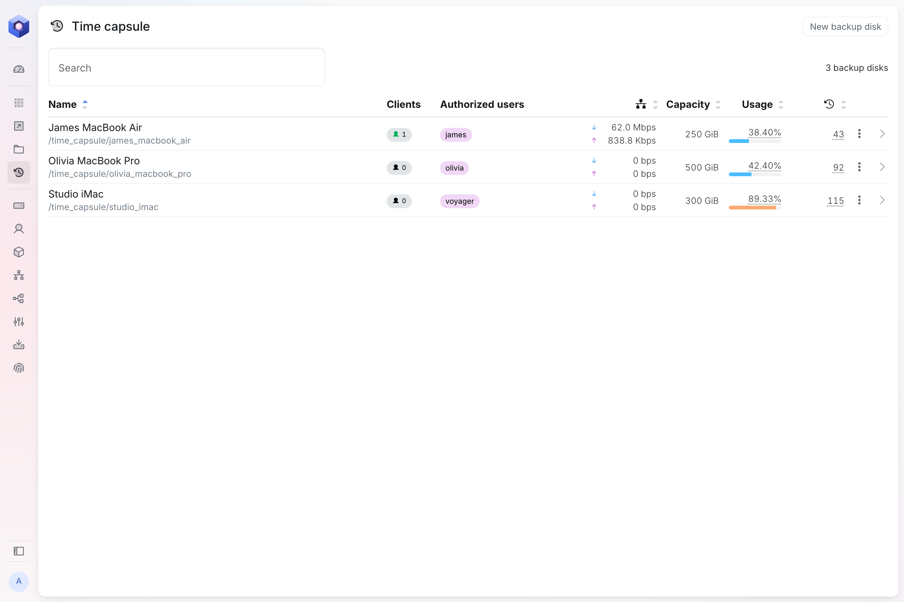
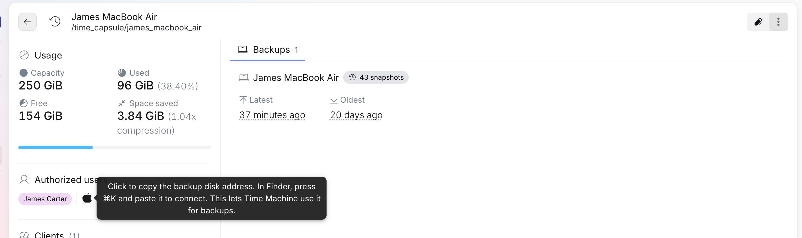

James spills coffee on his MacBook Air on a Tuesday morning. By the afternoon he has a new one on his desk, and by the evening it holds everything the old one did: his files, his apps, his settings, as they were at the last hour before the accident.

That is what Time Machine does when it has somewhere to back up to. On a univrs node, that somewhere is the node itself. This post covers how to set it up, what it keeps and how to get things back.

## A time capsule on your network

Time Machine is the backup app built into every Mac. It needs a destination, which Apple calls a backup disk. That can be a drive plugged into the Mac, but a drive on a desk is easy to forget to plug in, and it sits right next to the Mac it protects.

On a Mac, a node shows up as a **time capsule**: a place on the network that holds backup disks. Each backup disk has its own space on the node's storage pool, with a capacity of its own and one user who can reach it with their node username and password. The usual arrangement is one backup disk for each Mac.

Backups then happen on their own, over your network, whenever the Mac is on it. Nobody has to remember anything.

## Adding a backup disk

On the node, open **Time capsule** and select **New backup disk**. It asks for three things:

- **Name**, for example after the Mac that backs up to it.
- **Authorized user**, the user whose node username and password the Mac connects with.
- **Capacity**, how much space its backups can take up.

The capacity matters more than it looks. Time Machine fills whatever space it is given and only starts deleting old backups when the disk is full. Without a limit, one Mac could take the whole pool. With one, each Mac has its share and the rest of the node keeps its space.

## Connecting the Mac

In the backup disk's details, select the Apple icon next to its authorized user. This copies the backup disk's address, for example `smb://james@192.168.1.10/backup_disk_james_macbook_air`.

On the Mac:

1. In Finder, press **⌘K**, paste the address and select **Connect**. Enter the authorized user's node username and password.
2. Open **System Settings**, select **General**, then **Time Machine**.
3. Select **Add Backup Disk**, choose the backup disk and follow the steps.

Time Machine offers to encrypt the backups while you add the disk. With that on, the backups can only be read with the password you choose there, so keep it somewhere safe.

The first backup copies the whole Mac and takes a while. After that, Time Machine copies only what changed, once an hour.

## What it keeps

Time Machine keeps hourly backups for the past 24 hours, daily backups for the past month and weekly backups for every month before that. When the backup disk is full, it deletes the oldest ones to make room.

That history belongs to Time Machine, so backup disks are not part of the snapshots the node takes of everything else. They do sit on the same pool, though, which spreads its data over several drives so that it survives a failed one, and checks all of it once a month. A failed drive in the node does not take the backups with it. The pool also compresses what it stores, and the backup disk's details show how much space that saves.

## Keeping an eye on it

The **Time capsule** page lists every backup disk with the Macs connected to it right now, how much data it is receiving, how full it is and how many backups it holds. Hover over the number of backups to see the latest and the oldest.

A Mac whose latest backup is days old is one to ask about. Usually it has just been away from the office.

## Away from the office

Backup disks are reached over your local network only. They are never put on the internet, and there is no port to forward for them.

A laptop that leaves the office can still back up. Connected to [the node's VPN](/blog/vpn-on-virgoos/), it is on your network as far as the node is concerned, and Time Machine carries on as if it were at its desk.

## Getting things back

Restoring happens on the Mac, with Apple's own tools.

- **A file or a folder.** Open the folder it was in, then select **Browse Time Machine Backups** from the Time Machine menu in the menu bar. Go back in time to a version you want and select **Restore**.
- **A whole Mac.** On a new or erased Mac, open Migration Assistant, choose to transfer from a Time Machine backup and pick the backup disk on the node. This is how James got his MacBook Air back.

## When someone leaves

Locking a user on the node stops their Mac from backing up, since it can no longer connect. Unlocking them lets it carry on. Deleting a backup disk deletes every backup in it, so do that only once nobody needs them.

## Where to go next

- [Time capsule](https://docs.univrs.cloud/management/resources/time-capsule/) covers each backup disk's details and settings in full.
- [Away from the office: the VPN on a univrs node](/blog/vpn-on-virgoos/) covers backing up from home or on the road.
- [What virgoOS is, and what runs on it](/blog/what-virgoos-is/) is the short tour of everything else on a node.
