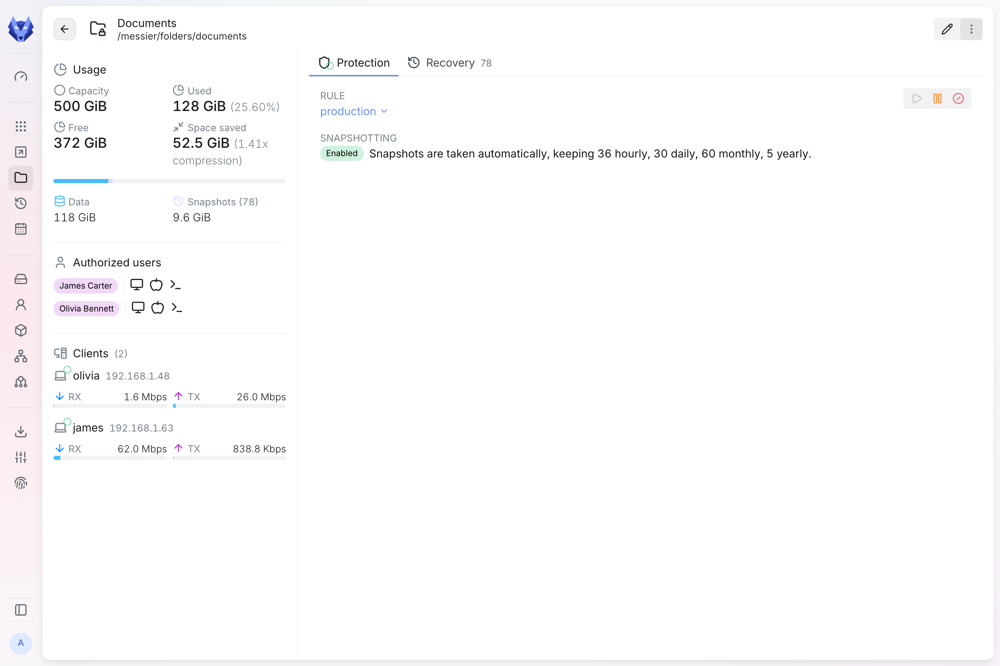

It is Tuesday afternoon. At 16:40, James opens an attachment from an email that looks like an invoice from a supplier. Nothing seems to happen.

On Wednesday morning, nobody can open anything in the firm's Documents folder. The contracts, the invoices and the price lists are all still there, but every file has a new ending to its name, and next to them is a note asking for money to unlock them.

This post is about what happens next on a univrs node: why the files are not lost, and how to put the whole folder back as it was before 16:40.

## What ransomware reaches

Ransomware runs on one computer, here James's laptop. It encrypts the files on that laptop, and then every file it can reach from there. The Documents folder on the node is open on James's laptop with his username and password, so to the ransomware it is just more files, and it encrypts them too.

The same goes for Nextcloud. If the laptop syncs files with the Nextcloud app, the encrypted files are synced to the node, the same way any other change would be.

So the files on the node are damaged. What the ransomware cannot reach is their history.

## Why the history survives

The node takes snapshots of every folder by itself, by default one for each of the last 36 hours, 30 days, 60 months and 5 years. Each one is a read-only copy of the folder as it was at that moment.

The snapshots are taken on the node, not on the laptops. James's laptop reaches the folder only as a shared folder, and through it a snapshot can neither be changed nor deleted. Whatever runs on the laptop, the snapshot from 16:00 still holds every file as it was at 16:00.

## First, the laptop

Before anything goes back, take James's laptop off the network: unplug its cable and keep it off the office Wi-Fi. Leave it off until it has been cleaned. A laptop that is still infected would encrypt the files again as soon as they are back.

## Finding the hour

In the folder's details, the **Recovery** tab lists its restore points on a timeline. The question is which one is the last from before 16:40.

Select **Browse files** next to a restore point to see the folder as it was then. The **Now** column compares each file with what the folder holds today. In the restore point from 16:00, nearly everything shows as changed since: that is the encryption, and it means the files in that restore point are the ones from before it. In the restore point from 17:00, the files already have their new endings.

To be sure, download a file from the 16:00 restore point and open it. Downloading is not available when you manage the node through your fleet, so open the node at its own address for that.

## Putting the folder back

When only a few files are damaged, restore just those and leave the rest of the folder as it is. Ransomware does not leave a few files, though. It leaves all of them, and for that there is **Roll back**.

Next to the 16:00 restore point, select **Roll back**. The confirmation says exactly what will happen: the folder is put back as it was at 16:00, and everything saved in it after that is permanently lost, together with the snapshots taken since then.

Tick **I understand this permanently erases data and this cannot be undone**, and select **Roll back** again. A notification shows when the folder has been rolled back. The encrypted files and the note are gone, and every contract, invoice and price list is back, as it was at 16:00.

What is lost is what was saved in the folder after 16:00. That is the firm's last 40 minutes of work on Tuesday: whatever was saved after 16:40 had been encrypted anyway.

## When it reached Nextcloud

Nextcloud can be rolled back the same way, from its own details. That puts every user's files back as they were at the restore point, not only James's, so everyone loses what they saved since.

When only James's files are damaged, there is a gentler way. Open **Browse files** in Nextcloud's restore point from 16:00, go into James's files and tick **Modified** and **Deleted** in the filter on the **Now** column. Select what is left and restore it: it all arrives in a new folder named after the restore point's date, and James's colleagues keep everything they did since.

## How far back

The recent restore points are an hour apart, so the work lost to a rollback is at most an hour's worth before the attack. When even that is too much, give the folder a [snapshot rule](https://docs.univrs.cloud/management/resources/snapshot-rules/) that also takes a snapshot every 15 minutes, and a rollback costs at most a quarter of an hour.

Some ransomware waits before it shows itself, and the damage is found days later. The daily restore points reach back 30 days and the monthly ones 5 years, so there is still a copy from before it began, only further apart.

All of this lives on the node itself. For a fire or a theft at the office, a second node in another building keeps a copy of the data and its snapshots too.

## Where to go next

- [Folder snapshots](https://docs.univrs.cloud/management/resources/folders/snapshots/) covers how folders are protected and their restore points.
- [Rolling back](https://docs.univrs.cloud/management/resources/folders/snapshots/rollback/) covers putting a whole folder back.
- [A file went missing](/blog/getting-a-file-back/) is the gentler case: one file, or a few, back from Nextcloud's history.
