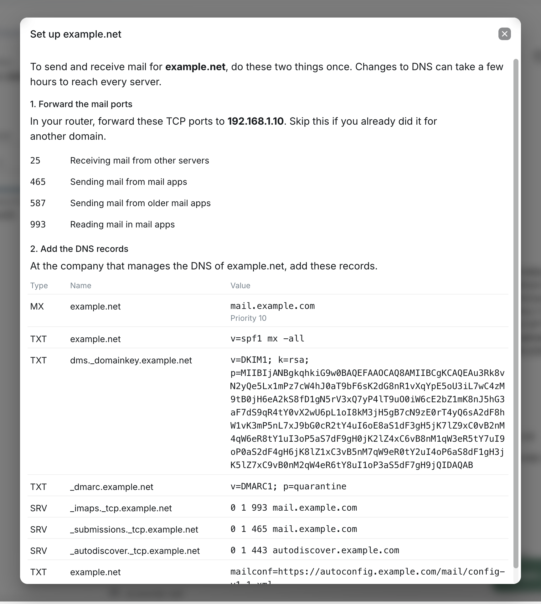
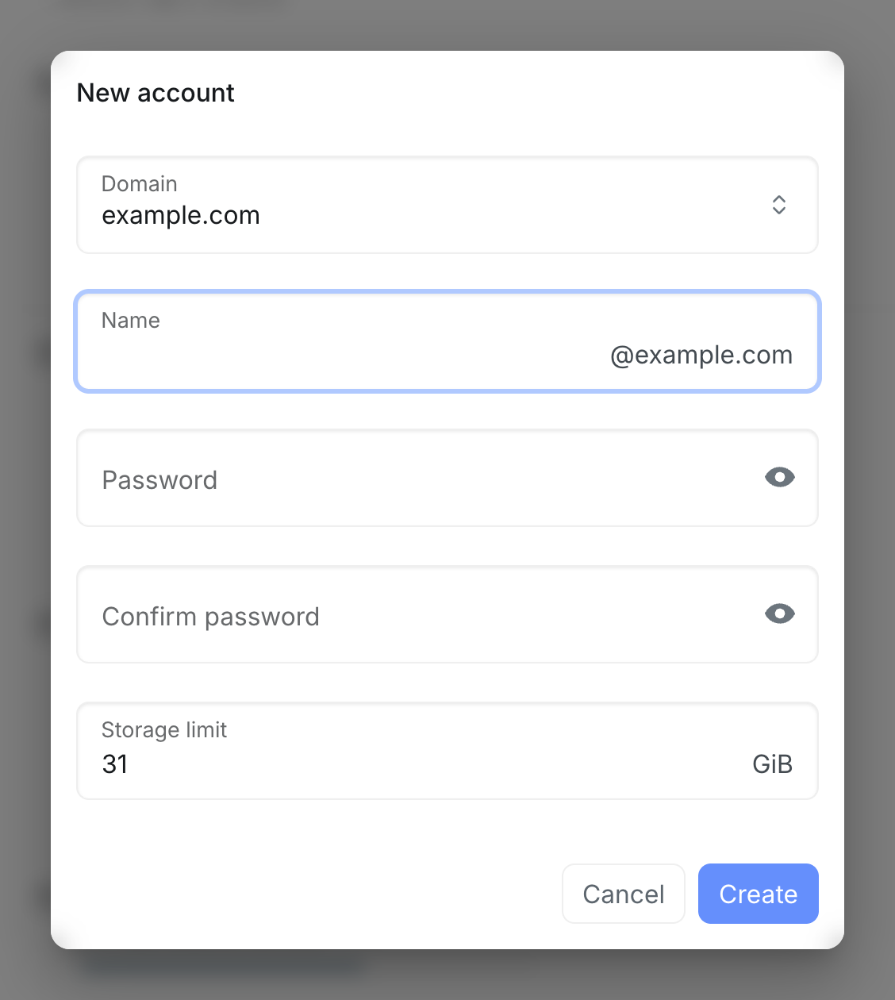
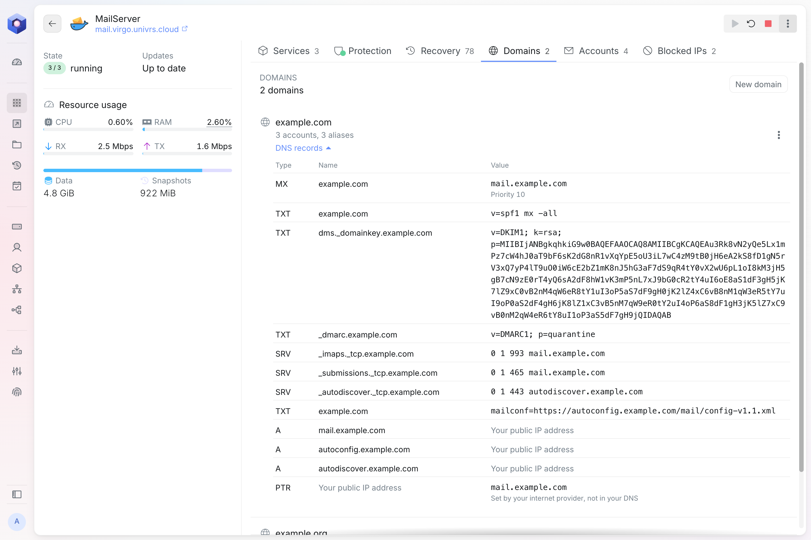
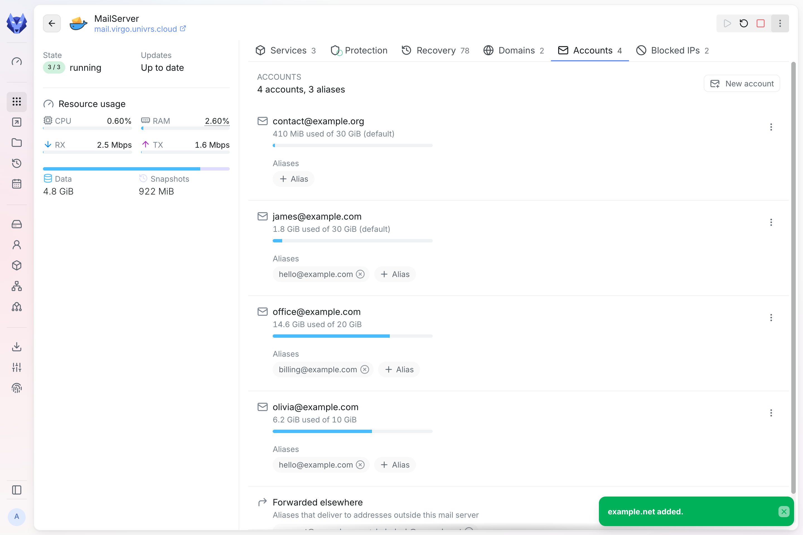
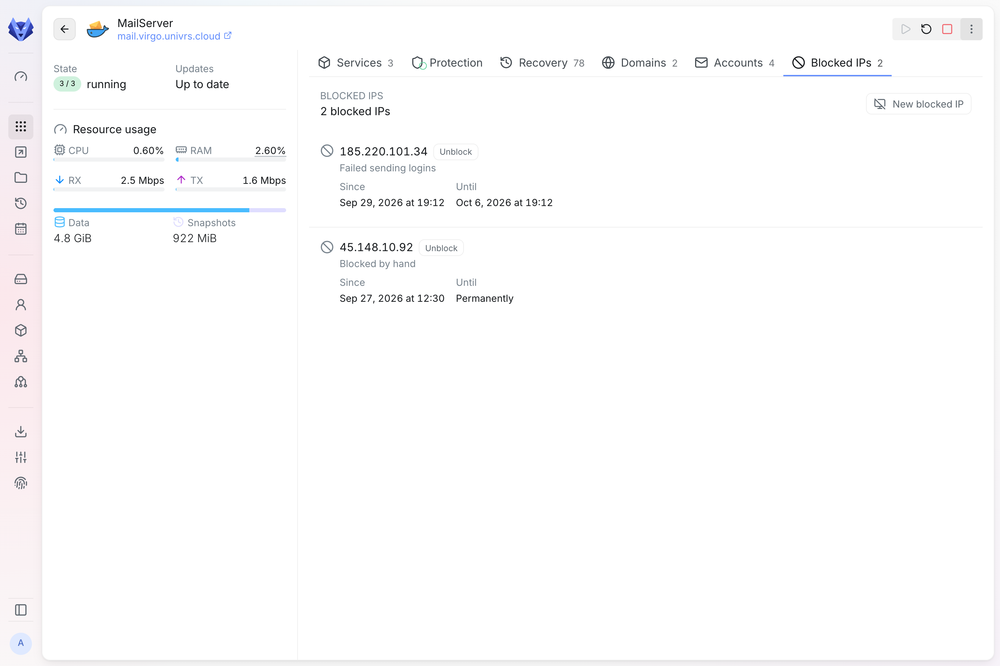

A univrs node can run your firm's email: addresses on your own domain, mailboxes on your own drives, no licence per mailbox. Of everything a node does, this is the part that asks the most of you. There are DNS records to create and a router to configure. The mailboxes, once it runs, are a few clicks in the node's interface.

This post goes through all of it in order. The examples use `example.com` as the domain and `203.0.113.10` as the public IP address. Replace them with yours.

## Before anything else: your connection

Email is the one app where the internet connection decides whether it can work at all. Check these before you install anything.

**A public IP address of your own.** Other mail servers have to reach yours directly. Behind CGNAT, where the provider shares one address between many customers, they cannot. [The ports guide](https://docs.univrs.cloud/setup/ports/) shows how to tell which kind of connection you have.

**A static one.** The DNS records below point at your address. If it changes, mail stops arriving until they are corrected.

**Port 25 open in both directions.** Many providers block outgoing port 25 on home connections, to stop spam. Mail servers talk to each other on that port and nothing else will do. Ask your provider, and ask for a business connection if that is what it takes.

**Reverse DNS.** Your IP address has to resolve back to `mail.example.com`. That record, called PTR, belongs to whoever owns the address, so only your provider can set it. Without it, the large mail providers reject or junk what you send.

If your provider cannot give you all four, self-hosted email is not for this connection, and it is better to know now.

## Mail cannot go through a proxy

Managing the node works from anywhere through your fleet, with no ports forwarded. Email does not work that way. The fleet carries the management interface and nothing else, so mail has to reach the node directly, on your public IP address.

The same goes for DNS providers that offer to proxy your records, such as Cloudflare with its orange cloud. Those proxies carry web traffic only. A proxied `mail` record points at the proxy, which does not accept mail. Set every record in this post to DNS only.

## What you are installing

The MailServer app in the App center is [docker-mailserver](https://docker-mailserver.github.io/docker-mailserver/latest/), set up for a node. It receives and sends mail (SMTP), keeps the mailboxes and serves them to mail clients (IMAP), filters spam with Rspamd, scans attachments with ClamAV, and bans addresses that keep guessing passwords with fail2ban. Next to it run a small DNS resolver of its own and a service that tells mail clients how to configure themselves.

There is no webmail in it. People read their mail in a mail client: Thunderbird, Outlook, Apple Mail, or the mail app on their phone.

## Before installing

The node gets the mail server's certificates as soon as it is installed, so two things have to be in place first. On your router, forward TCP ports 80 and 443 to the node. At your DNS provider, point `mail`, `autoconfig` and `autodiscover` at your public IP address, each with an A record. Do not add AAAA (IPv6) records for them: the mail server is set up for IPv4 only.

The mail ports and the rest of the DNS records come after the install. The node lists them for you.

## Install the app

In the App center, select **Install** on MailServer. The form asks for three things:

- **MX domain**, the domain your addresses end in: `example.com`. The mail server itself will answer as `mail.example.com`.
- **Domain**, the node's own domain. The spam filter's interface is served on the `rspamd` name under it, behind the node login.
- **HTTPS certificate** for that interface.

The certificate for `mail.example.com` always comes from Let's Encrypt, which is why port 80 and the `mail` record have to be in place.

Everything after this is done in MailServer's details: in **Apps**, open MailServer. Among its tabs are **Domains**, **Accounts** and **Blocked IPs**.

## Add your domain and the first mailbox, quickly

A freshly installed mail server has no accounts, and it will not finish starting without one. It waits two minutes, then stops and is started again. So the first two steps have a deadline. If MailServer says it is not running, wait for it to start again and carry on.

In **Domains**, select **New domain** and enter `example.com`. Adding a domain creates its DKIM key, the key that signs every message you send so the receiving server can check that it really comes from your domain. A window then shows everything the domain still needs: the ports to forward and the DNS records to add.



Close it for now, the account comes first, and go to **Accounts**. Select **New account**, keep the domain, type the name in front of `@example.com`, and set the password twice. The storage limit starts at MailServer's default, 30 GiB. Keep it, or give the account a limit of its own.



## Forward the mail ports and add the DNS records

On your router, forward the TCP ports the window listed to the node: 25 for other mail servers delivering to you, 465 and 587 for mail clients sending, and 993 for mail clients reading.

Then, back in **Domains**, select **DNS records** under `example.com`. It lists every record the domain needs, with its type, name and value, the three A records you created before installing among them.



Copy the ones you do not have yet to your DNS provider. That makes eleven records at your DNS provider, plus the reverse DNS record at your internet provider, which the list shows last as PTR.

- **MX** tells the world that mail for `@example.com` is delivered to `mail.example.com`, your node.
- **SPF** says which servers may send mail for your domain. `mx` means the ones in your MX record, which is your node, and `-all` tells receivers to refuse mail for your domain from anywhere else.
- **DKIM** publishes the public half of the key the node created. The value is longer than 255 characters, the most a single piece of a TXT record can hold. Most DNS providers split it for you. If yours refuses it, split it into several quoted pieces yourself.
- **DMARC** tells receivers what to do with mail that fails those checks. `p=quarantine` asks them to put it in spam.
- **The SRV records and `mailconf`** are what [configures mail clients](#setting-up-mail-clients) without anyone typing a server name. In an SRV value the four parts are priority, weight, port and server, and most DNS providers have a separate field for each.

The node's notices go to `postmaster@example.com`. Make that address land in a real mailbox: in **Accounts**, select **Alias** under your own account and add `postmaster@example.com`.

## Check your work

From any computer, ask DNS what the world now sees:

```sh
dig +short MX example.com
dig +short TXT example.com
dig +short TXT dms._domainkey.example.com
dig +short TXT _dmarc.example.com
dig +short SRV _imaps._tcp.example.com
dig +short -x 203.0.113.10
```

The last one is the reverse lookup and should answer `mail.example.com.`

Then send a message to an address at one of the large providers and look at its headers there. Gmail shows them under **Show original**, with SPF, DKIM and DMARC each marked as passed or failed. All three should pass before anyone relies on the server.

## Setting up mail clients

The node tells mail clients what the settings are, so in most of them a person types their name, their address and their password, and nothing else.

- **Thunderbird** looks the settings up at `autoconfig.example.com` by itself.
- **Outlook** asks `autodiscover.example.com`. How well that works depends on the Outlook version, so keep the manual settings at hand.
- **iPhone, iPad and Apple Mail** use a configuration profile. Open `https://autodiscover.example.com` on the device. The page has a form that produces the profile for an address, which is then installed from the device's settings.

The page at `https://autodiscover.example.com` is also where to send people who are stuck: it shows the settings for manual configuration.

For any client that finds nothing by itself, these are the settings:

| | Server | Port | Security |
| --- | --- | --- | --- |
| Incoming (IMAP) | `mail.example.com` | 993 | SSL/TLS |
| Outgoing (SMTP) | `mail.example.com` | 465 | SSL/TLS |

The username is the full email address, and the password is the one set for the account. For clients that insist on STARTTLS for sending, use port 587.

## Day to day

**Accounts** lists the mailboxes, each with the space its mail takes up and its storage limit, and under each one the aliases that deliver to it. Aliases that forward to addresses outside the node are grouped at the end, under **Forwarded elsewhere**.



- **A new mailbox:** **New account**, as for the first one.
- **A new password, a different limit, or closing an account:** the account's menu. Deleting an account permanently deletes its mail and its aliases.
- **An alias**, an address without a mailbox of its own, such as `office@example.com`: select **Alias** under the mailbox that should receive its mail. Add the same alias under several accounts and they all receive it. The cross on an alias removes it.
- **A second domain:** **New domain** in **Domains**. It gets its own DKIM key and its own list of DNS records, and its addresses can then be picked in **New account**.
- **A new DKIM key:** **New DKIM key** in the domain's menu. The old record stops working, so update the DNS right away.

What you change here is kept with the app's data, on the storage pool, so it survives updates.

## Unblocking an address

The mail server blocks an IP address after six failed sign-ins within a week, and the block lasts a week. It covers every mail port, so for the person behind that address mail simply stops: the client cannot connect at all, even with the right password. The usual cause is a phone or laptop that kept trying an old password after it was changed.

A block is on the address, not on the account. Everyone who shares that connection is locked out with them, and the same person can still read mail from another connection, such as mobile data.

**Blocked IPs** lists the blocked addresses, with why each one was blocked, since when and until when.



If the list is empty, the problem is elsewhere. With several addresses in it, you need to know which one is theirs: ask the person to open a site such as [ipinfo.io](https://ipinfo.io/) on the connection that stopped working, and to read you the address it shows.

Then fix the cause, or the block comes straight back: put the right password in the mail client on every device that person uses. Now select **Unblock** next to the address. It takes effect at once.

**New blocked IP** does the opposite, for an address you want kept out yourself.

## Tips

- **If your provider blocks outgoing port 25** and will not open it, the server can send through a relay service, while receiving directly. This is the one thing the interface does not set: it is done with the `setup relay` command in the **Terminal** of the `mailserver` container, under **Services**, as the [docker-mailserver documentation](https://docker-mailserver.github.io/docker-mailserver/latest/) describes.
- **Teach the spam filter.** Moving a message into Junk teaches it that such mail is spam, and moving one from Junk to the inbox teaches the opposite. The filter learns for everyone at once, so one careful person helps all the others.
- **Look at the logs first.** When mail does not arrive, **Logs** on the `mailserver` container usually says why, in the words of the server that refused it.
- **Keep a copy of the DNS records.** If you ever change DNS providers, every one of them has to be created again, DKIM included.
- **The mailboxes are in the snapshots.** Mail is kept on the storage pool with the rest of the app's data, so it is part of the same history as everything else on the node.

## Caveats

- **There is no self-service.** People cannot change their own password. You do it for them, from their account's menu.
- **Senders have to be themselves.** A person can only send from their own address or from an alias that delivers to them. A client set to send as someone else is refused.
- **Some first messages arrive late.** The spam filter greylists mail it finds suspicious: it asks the sending server to try again later. Legitimate servers do, so the message arrives a little later.
- **One message can be 25 MB at most.** Attachments grow by about a third when they are sent, so the practical limit for a file is around 18 MB.
- **Wrong passwords get you blocked.** A phone that keeps trying an old password ends up blocked by fail2ban, and mail stops working from that connection until you [unblock it](#unblocking-an-address).
- **When the node is off, mail waits.** Sending servers keep trying for a while, usually for days, before giving up. With a secondary node installed, the mail is replicated and fails over to it.
- **A new server has no reputation.** For the first weeks, large providers may put your messages in spam even when every check passes. It improves as people receive and answer your mail.

## Why it is worth it

For a firm that keeps other people's confidential correspondence, an afternoon of DNS records buys mail on its own drives, on its own domain, with no licence per mailbox and nobody else reading along. Once the connection checks out, the rest is a few clicks, and the mail is yours for as long as you run it.

## Where to go next

- [Port forwarding](https://docs.univrs.cloud/setup/ports/) covers the ports and how to check for CGNAT.
- [MailServer](https://docs.univrs.cloud/management/resources/apps/mailserver/) covers its domains, accounts, aliases and blocked IPs.
- [The docker-mailserver documentation](https://docker-mailserver.github.io/docker-mailserver/latest/) covers everything the mail server can do beyond this post.
- [What virgoOS is, and what runs on it](/blog/what-virgoos-is/) is the short tour of the rest.
