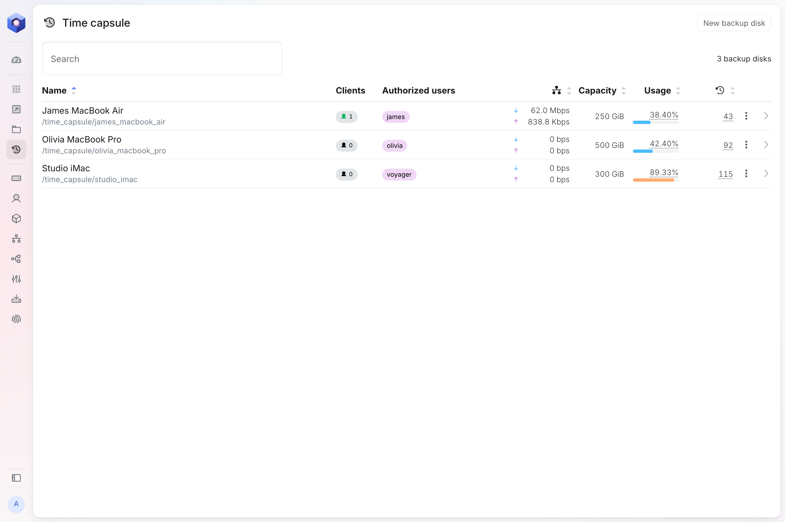
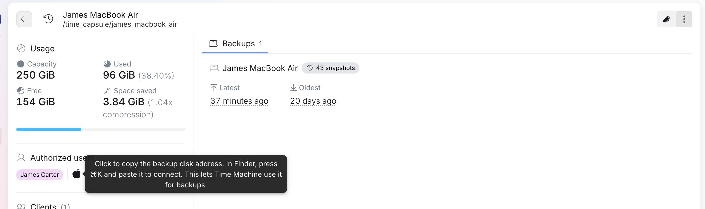

Marți dimineață, lui James i se varsă cafeaua pe MacBook Air. Până după-amiază are unul nou pe birou, iar seara pe el se află tot ce era pe cel vechi: fișierele, aplicațiile, setările, așa cum erau cu o oră înainte de accident.

Asta face Time Machine atunci când are unde să facă backupul. Pe un nod univrs, locul acela este chiar nodul. Articolul arată cum îl configurați, ce păstrează și cum recuperați ce vă trebuie.

## Un time capsule în rețeaua dumneavoastră

Time Machine este aplicația de backup inclusă în orice Mac. Are nevoie de o destinație, pe care Apple o numește disc de backup. Poate fi un hard disk extern conectat la Mac, dar un disc ținut pe birou se uită ușor neconectat și stă chiar lângă Mac-ul pe care ar trebui să-l protejeze.

Pe Mac, nodul apare ca un **time capsule**: un loc din rețea care găzduiește discuri de backup. Fiecare disc de backup are propriul spațiu în pool-ul de stocare al nodului, cu o capacitate doar a lui și un singur utilizator care ajunge la el cu numele de utilizator și parola de pe nod. De obicei, fiecare Mac are discul lui de backup.

De acolo, backupurile se fac singure, prin rețea, ori de câte ori Mac-ul este conectat la ea. Nimeni nu trebuie să-și amintească nimic.

## Adăugați un disc de backup

Pe nod, deschideți **Time capsule** și selectați **New backup disk**. Vi se cer trei lucruri:

- **Name**, de exemplu după Mac-ul care își face backupul acolo.
- **Authorized user**, utilizatorul cu al cărui nume și parolă de pe nod se conectează Mac-ul.
- **Capacity**, cât spațiu pot ocupa backupurile lui.

Capacitatea contează mai mult decât pare. Time Machine umple tot spațiul pe care îl primește și începe să șteargă backupurile vechi abia când discul s-a umplut. Fără o limită, un singur Mac ar putea ocupa tot pool-ul. Cu limită, fiecare Mac are partea lui, iar restul nodului își păstrează spațiul.

## Conectați Mac-ul

În detaliile discului de backup, selectați iconița Apple de lângă utilizatorul autorizat. Astfel copiați adresa discului, de exemplu `smb://james@192.168.1.10/backup_disk_james_macbook_air`.

Pe Mac:

1. În Finder, apăsați **⌘K**, lipiți adresa și conectați-vă cu numele de utilizator și parola de pe nod ale utilizatorului autorizat.
2. Deschideți setările sistemului, apoi General și Time Machine.
3. Adăugați un disc de backup, alegeți-l pe cel de pe nod și urmați pașii.

Când adăugați discul, Time Machine vă oferă și criptarea backupurilor. Dacă o activați, backupurile pot fi citite doar cu parola pe care o alegeți atunci, așa că păstrați-o într-un loc sigur.

Primul backup copiază tot Mac-ul și durează ceva. După aceea, Time Machine copiază doar ce s-a schimbat, o dată pe oră.

## Ce păstrează

Time Machine păstrează câte un backup pe oră pentru ultimele 24 de ore, câte unul pe zi pentru ultima lună și câte unul pe săptămână pentru toate lunile dinainte. Când discul de backup se umple, le șterge pe cele mai vechi ca să facă loc.

Istoricul acesta îl ține Time Machine, așa că discurile de backup nu intră în snapshoturile pe care nodul le face pentru restul datelor. Stau totuși pe același pool, care își împarte datele pe mai multe discuri, ca să supraviețuiască defectării unuia, și le verifică pe toate o dată pe lună. Dacă se strică un disc din nod, backupurile nu se pierd odată cu el. Pool-ul și comprimă ce stochează, iar detaliile discului de backup arată cât spațiu se economisește astfel.

## Cu ochii pe backupuri

Pagina **Time capsule** listează fiecare disc de backup, cu Mac-urile conectate la el în acel moment, câte date primește, cât de plin este și câte backupuri conține. Țineți cursorul pe numărul de backupuri ca să vedeți cel mai recent și cel mai vechi.

Un Mac al cărui ultim backup are câteva zile merită o întrebare. De cele mai multe ori a fost doar plecat din birou.

## Departe de birou

La discurile de backup se ajunge doar din rețeaua locală. Nu sunt expuse niciodată în internet și pentru ele nu există niciun port de redirecționat.

Un laptop plecat din birou își poate face totuși backupul. Conectat la [VPN-ul nodului](/ro/blog/vpn-on-virgoos/), pentru nod este în rețea, iar Time Machine continuă ca și cum laptopul ar fi la birou.

## Recuperarea

Restaurarea se face pe Mac, cu instrumentele Apple.

- **Un fișier sau un folder.** Deschideți folderul în care se afla, apoi intrați în Time Machine din meniul lui din bara de meniu. Mergeți înapoi în timp până la versiunea care vă trebuie și restaurați-o.
- **Un Mac întreg.** Pe un Mac nou sau șters, deschideți Asistentul de migrare, alegeți transferul dintr-un backup Time Machine și selectați discul de backup de pe nod. Așa și-a recuperat James MacBook Air-ul.

## Când pleacă cineva

Dacă blocați un utilizator pe nod, Mac-ul lui nu își mai poate face backupul, fiindcă nu se mai poate conecta. După deblocare, își reia backupurile. Ștergerea unui disc de backup șterge toate backupurile din el, așa că faceți-o doar când nu mai are nimeni nevoie de ele.

## Mai departe

- [Time capsule](https://docs.univrs.cloud/management/resources/time-capsule/), în limba engleză, prezintă pe larg detaliile și setările fiecărui disc de backup.
- [Departe de birou: VPN-ul de pe un nod univrs](/ro/blog/vpn-on-virgoos/) arată cum faceți backup de acasă sau de pe drum.
- [Ce este virgoOS și ce rulează pe el](/ro/blog/what-virgoos-is/) este turul scurt al tuturor celorlalte lucruri de pe un nod.
