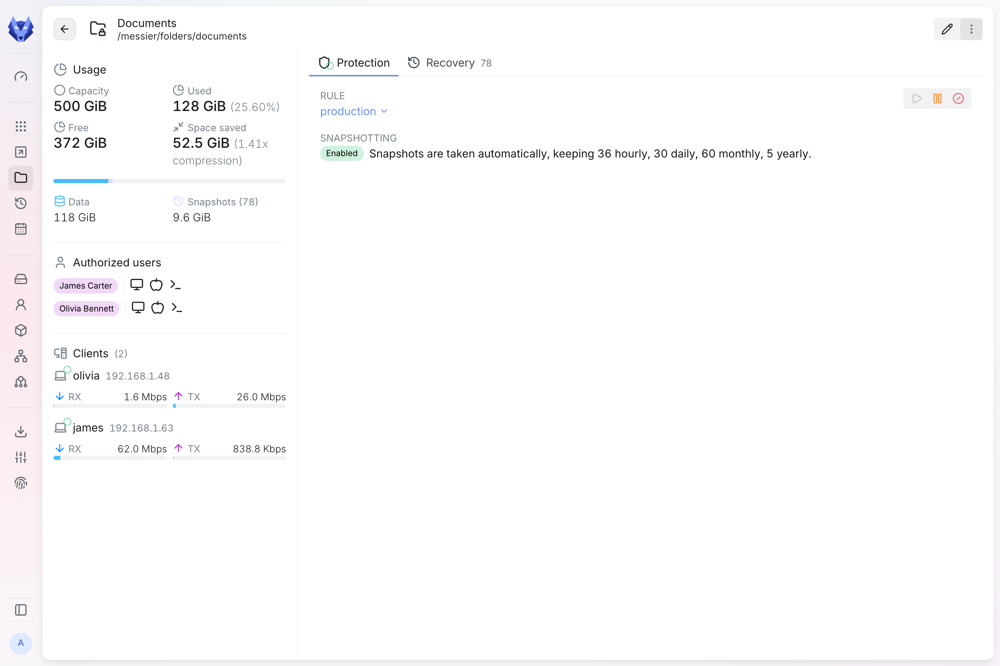

Este marți după-amiază. La 16:40, James deschide atașamentul unui e-mail care pare o factură de la un furnizor. Aparent, nu se întâmplă nimic.

Miercuri dimineață, nimeni nu mai poate deschide nimic din folderul Documents al firmei. Contractele, facturile și listele de prețuri sunt toate acolo, dar fiecare fișier are acum o terminație nouă în nume, iar lângă ele stă un mesaj care cere bani pentru deblocare.

Articolul arată ce urmează pe un nod univrs: de ce fișierele nu sunt pierdute și cum puneți la loc tot folderul, așa cum era înainte de 16:40.

## Până unde ajunge un ransomware

Un ransomware rulează pe un singur calculator, aici laptopul lui James. Criptează fișierele de pe laptop, apoi tot ce poate atinge de acolo. Folderul Documents de pe nod este deschis pe laptopul lui James cu numele lui de utilizator și parola lui, așa că, pentru ransomware, sunt doar alte fișiere, pe care le criptează și pe ele.

La fel se întâmplă cu Nextcloud. Dacă laptopul sincronizează fișiere prin aplicația Nextcloud, fișierele criptate ajung pe nod prin sincronizare, ca orice altă modificare.

Așadar, fișierele de pe nod sunt stricate. Ce nu poate atinge ransomware-ul este istoricul lor.

## De ce rămâne istoricul

Nodul face singur snapshoturi pentru fiecare folder, implicit câte unul pentru fiecare dintre ultimele 36 de ore, 30 de zile, 60 de luni și 5 ani. Fiecare este o copie doar pentru citire a folderului, așa cum era în acel moment.

Snapshoturile le face nodul, nu laptopurile. Laptopul lui James vede folderul doar ca folder partajat, iar prin el un snapshot nu poate fi nici modificat, nici șters. Orice ar rula pe laptop, snapshotul de la 16:00 păstrează în continuare fiecare fișier așa cum era la 16:00.

## Întâi, laptopul

Înainte să puneți ceva la loc, scoateți laptopul lui James din rețea: deconectați cablul și nu îl lăsați să se conecteze la Wi-Fi-ul biroului. Țineți-l deconectat până este curățat. Un laptop încă infectat ar cripta fișierele din nou, imediat ce sunt puse la loc.

## Găsiți ora

În detaliile folderului, tabul **Recovery** arată punctele de restaurare pe o axă a timpului. Întrebarea este care e ultimul de dinainte de 16:40.

Apăsați **Browse files** lângă un punct de restaurare ca să vedeți folderul așa cum era atunci. Coloana **Now** compară fiecare fișier cu ce conține folderul astăzi. În punctul de restaurare de la 16:00, aproape totul apare modificat de atunci: asta este criptarea, și înseamnă că fișierele din acel punct sunt cele de dinainte. În punctul de restaurare de la 17:00, fișierele au deja terminațiile noi.

Ca să fiți siguri, descărcați un fișier din punctul de restaurare de la 16:00 și deschideți-l. Descărcarea nu este disponibilă când administrați nodul prin fleet, așa că pentru ea deschideți nodul la propria lui adresă.

## Puneți folderul la loc

Când sunt stricate doar câteva fișiere, le restaurați doar pe ele, iar restul folderului rămâne cum este. Numai că un ransomware nu se oprește la câteva fișiere. Le strică pe toate, iar pentru asta există **Roll back**.

Lângă punctul de restaurare de la 16:00, apăsați **Roll back**. Confirmarea spune exact ce se va întâmpla: folderul revine la cum era la 16:00, iar tot ce s-a salvat în el după aceea se pierde definitiv, împreună cu snapshoturile făcute de atunci.

Bifați **I understand this permanently erases data and this cannot be undone** și apăsați din nou **Roll back**. O notificare vă anunță când folderul a fost readus. Fișierele criptate și mesajul au dispărut, iar toate contractele, facturile și listele de prețuri sunt la loc, așa cum erau la 16:00.

Se pierde doar ce s-a salvat în folder după 16:00. Adică ultimele 40 de minute de lucru ale firmei de marți: ce s-a salvat după 16:40 fusese oricum criptat.

## Când a ajuns în Nextcloud

Și Nextcloud poate fi readus la un punct de restaurare, din propriile detalii. Asta pune la loc fișierele tuturor utilizatorilor așa cum erau atunci, nu doar pe ale lui James, deci fiecare pierde ce a salvat între timp.

Când sunt stricate doar fișierele lui James, există o cale mai blândă. Deschideți **Browse files** în punctul de restaurare de la 16:00 al aplicației Nextcloud, intrați în fișierele lui James și bifați **Modified** și **Deleted** în filtrul coloanei **Now**. Selectați ce a rămas și restaurați: totul ajunge într-un folder nou, numit după data punctului de restaurare, iar colegii lui James păstrează tot ce au lucrat între timp.

## Cât de departe în urmă

Punctele de restaurare recente sunt la o oră unul de altul, așa că o readucere vă costă cel mult munca dintr-o oră de dinaintea atacului. Dacă și asta e prea mult, alegeți pentru folder o [regulă de snapshot](https://docs.univrs.cloud/management/resources/snapshot-rules/) care face câte un snapshot și la fiecare 15 minute, iar o readucere vă costă cel mult un sfert de oră.

Unele ransomware-uri așteaptă înainte să se arate, iar paguba se descoperă abia după câteva zile. Punctele de restaurare zilnice merg 30 de zile în urmă, iar cele lunare 5 ani, deci există în continuare o copie de dinainte să înceapă, doar mai rară.

Toate acestea stau pe nodul însuși. Pentru un incendiu sau un furt la birou, un al doilea nod, în altă clădire, păstrează și el o copie a datelor și a snapshoturilor lor.

## Ce urmează

- [Folder snapshots](https://docs.univrs.cloud/management/resources/folders/snapshots/), în limba engleză, descrie cum sunt protejate folderele și punctele lor de restaurare.
- [Rolling back](https://docs.univrs.cloud/management/resources/folders/snapshots/rollback/), în limba engleză, descrie cum puneți la loc un folder întreg.
- [A dispărut un fișier](/ro/blog/getting-a-file-back/) este cazul mai blând: un fișier sau câteva, recuperate din istoricul Nextcloud.
