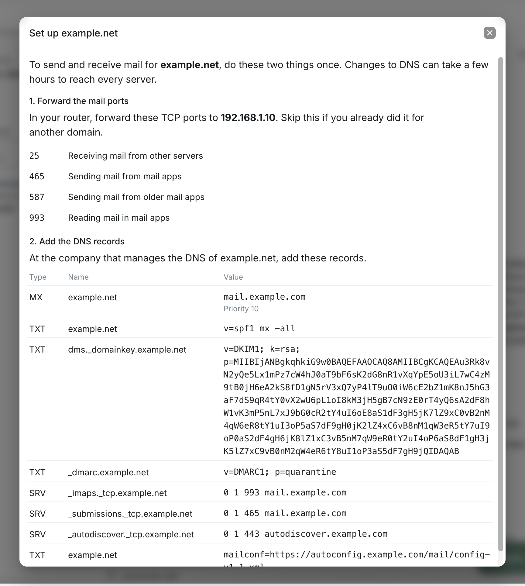
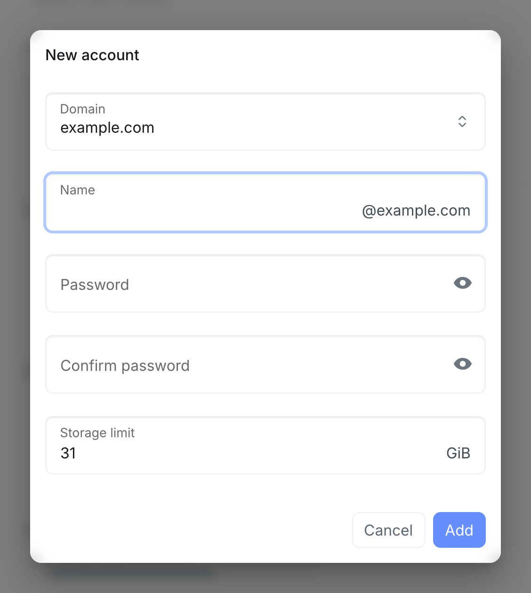
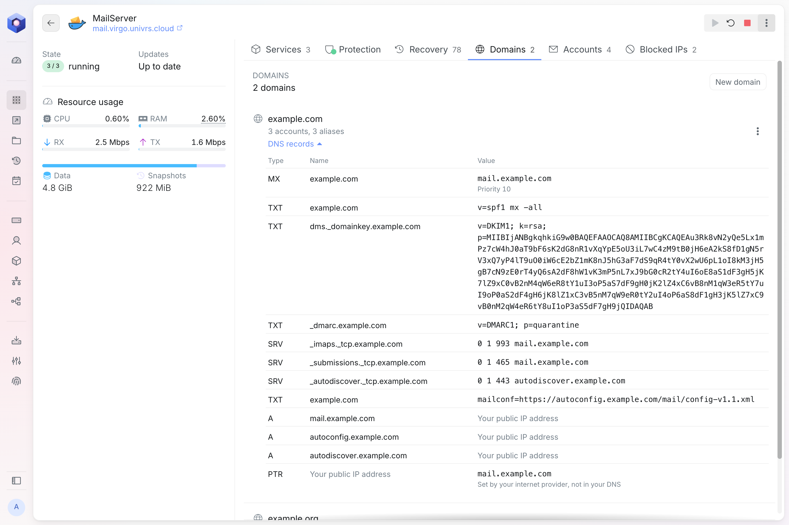
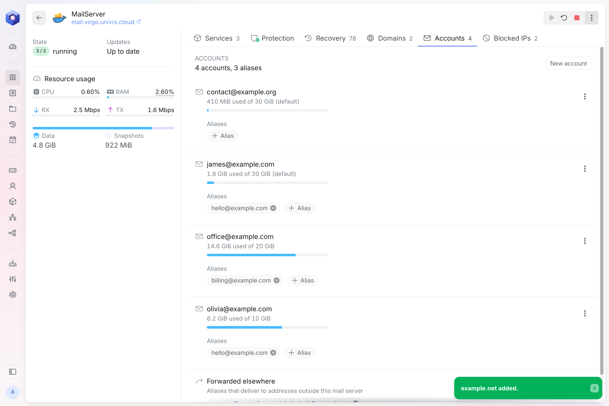
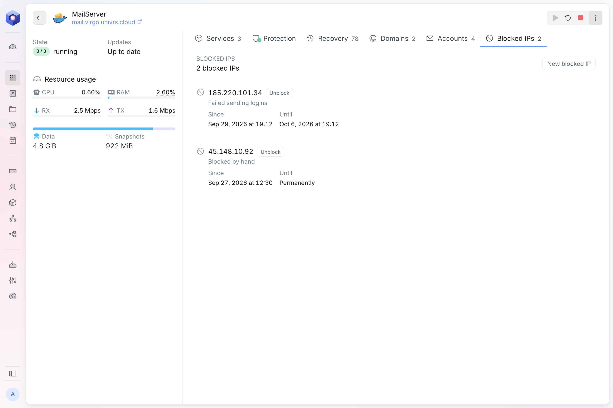

Un nod univrs poate găzdui e-mailul firmei: adrese pe propriul domeniu, căsuțe pe propriile discuri, fără licență pentru fiecare căsuță. Dintre toate lucrurile pe care le face un nod, acesta vă cere cel mai mult. Aveți de creat înregistrări DNS și de configurat un router. Căsuțele, după ce serverul pornește, înseamnă câteva clicuri în interfața nodului.

Articolul le ia pe toate, în ordine. Exemplele folosesc `example.com` ca domeniu și `203.0.113.10` ca adresă IP publică. Înlocuiți-le cu ale dumneavoastră.

## Înainte de orice: conexiunea la internet

E-mailul este singura aplicație la care conexiunea la internet hotărăște dacă poate funcționa sau nu. Verificați lucrurile de mai jos înainte să instalați ceva.

**O adresă IP publică, numai a dumneavoastră.** Celelalte servere de e-mail trebuie să ajungă direct la al dumneavoastră. În spatele CGNAT, unde furnizorul împarte o singură adresă între mai mulți clienți, nu au cum. [Ghidul porturilor](https://docs.univrs.cloud/setup/ports/), în limba engleză, arată cum aflați ce fel de conexiune aveți.

**Una statică.** Înregistrările DNS de mai jos indică adresa dumneavoastră. Dacă ea se schimbă, e-mailurile nu mai ajung până când le corectați.

**Portul 25 deschis în ambele sensuri.** Mulți furnizori blochează portul 25 la ieșire pe conexiunile rezidențiale, ca să oprească spamul. Serverele de e-mail vorbesc între ele pe acest port și pe niciun altul. Întrebați furnizorul și cereți o conexiune business, dacă de asta este nevoie.

**Reverse DNS.** Adresa IP trebuie să se rezolve înapoi în `mail.example.com`. Această înregistrare, numită PTR, aparține celui care deține adresa, deci o poate seta doar furnizorul. Fără ea, marii furnizori de e-mail resping ce trimiteți sau îl pun în spam.

Dacă furnizorul nu vi le poate da pe toate patru, e-mailul găzduit pe propriul server nu este pentru această conexiune, și e mai bine să aflați acum.

## E-mailul nu poate trece printr-un proxy

Nodul îl puteți administra de oriunde prin fleet, fără niciun port redirecționat. E-mailul nu funcționează așa. Prin fleet trece doar interfața de administrare, deci e-mailul trebuie să ajungă direct la nod, pe adresa dumneavoastră IP publică.

La fel stau lucrurile cu furnizorii de DNS care se oferă să vă treacă înregistrările printr-un proxy, cum face Cloudflare cu norul portocaliu. Un astfel de proxy transportă doar trafic web. O înregistrare `mail` trecută prin proxy duce la proxy, care nu primește e-mail. Lăsați toate înregistrările din acest articol pe „DNS only”.

## Ce instalați

Aplicația MailServer din App center este [docker-mailserver](https://docker-mailserver.github.io/docker-mailserver/latest/), pregătit pentru un nod. Primește și trimite e-mailuri (SMTP), păstrează căsuțele și le pune la dispoziția clienților de e-mail (IMAP), filtrează spamul cu Rspamd, scanează atașamentele cu ClamAV și blochează, cu fail2ban, adresele care tot încearcă parole. Alături rulează un mic resolver DNS propriu și un serviciu care le spune clienților de e-mail cum să se configureze.

Webmail nu există. Oamenii își citesc e-mailul într-un client: Thunderbird, Outlook, Apple Mail sau aplicația de e-mail de pe telefon.

## Înainte de instalare

Nodul obține certificatele serverului de e-mail imediat după instalare, așa că două lucruri trebuie să existe dinainte. În router, redirecționați către nod porturile TCP 80 și 443. La furnizorul de DNS, îndreptați `mail`, `autoconfig` și `autodiscover` către adresa dumneavoastră IP publică, fiecare cu o înregistrare A. Nu adăugați pentru ele înregistrări AAAA (IPv6): serverul de e-mail este configurat doar pentru IPv4.

Porturile de e-mail și restul înregistrărilor DNS vin după instalare. Nodul vi le arată.

## Instalați aplicația

În App center, apăsați **Install** la MailServer. Formularul cere trei lucruri:

- **MX domain**, domeniul în care se termină adresele: `example.com`. Serverul de e-mail va răspunde la `mail.example.com`.
- **Domain**, domeniul nodului. Interfața filtrului de spam se deschide la numele `rspamd` de sub el, după autentificarea pe nod.
- **HTTPS certificate** pentru această interfață.

Certificatul pentru `mail.example.com` vine întotdeauna de la Let's Encrypt, de aceea portul 80 și înregistrarea `mail` trebuie să existe deja.

Tot ce urmează se face în detaliile aplicației: în **Apps**, deschideți MailServer. Printre filele lui sunt **Domains**, **Accounts** și **Blocked IPs**.

## Adăugați domeniul și prima căsuță, repede

Un server de e-mail abia instalat nu are niciun cont și nu își termină pornirea fără unul. Așteaptă două minute, apoi se oprește și este pornit din nou. Primii doi pași au, așadar, un termen. Dacă MailServer spune că nu rulează, așteptați să pornească din nou și continuați.

În **Domains**, apăsați **New domain** și scrieți `example.com`. Adăugarea unui domeniu îi creează cheia DKIM, cea care semnează fiecare mesaj trimis, astfel încât serverul care îl primește să poată verifica că vine într-adevăr de pe domeniul dumneavoastră. O fereastră arată apoi tot ce îi mai trebuie domeniului: porturile de redirecționat și înregistrările DNS de adăugat.



Închideți-o deocamdată, contul are întâietate, și treceți la **Accounts**. Apăsați **New account**, lăsați domeniul, scrieți numele din fața lui `@example.com` și puneți parola de două ori. Limita de stocare pornește de la valoarea implicită a aplicației, 30 GiB. Lăsați-o așa sau dați-i contului o limită proprie.



## Redirecționați porturile de e-mail și adăugați înregistrările DNS

În router, redirecționați către nod porturile TCP din fereastră: 25 pentru celelalte servere de e-mail, când vă livrează mesaje, 465 și 587 pentru clienții de e-mail, la trimitere, și 993 pentru clienții de e-mail, la citire.

Apoi, înapoi în **Domains**, apăsați **DNS records** sub `example.com`. Apar toate înregistrările de care are nevoie domeniul, cu tipul, numele și valoarea lor, inclusiv cele trei înregistrări A create înainte de instalare.



Copiați la furnizorul de DNS pe cele pe care nu le aveți încă. Ajungeți astfel la unsprezece înregistrări la furnizorul de DNS, plus înregistrarea reverse DNS de la furnizorul de internet, pe care lista o arată ultima, ca PTR.

- **MX** spune lumii că mesajele pentru `@example.com` se livrează la `mail.example.com`, adică la nodul dumneavoastră.
- **SPF** spune ce servere au voie să trimită e-mail pentru domeniu. `mx` înseamnă cele din înregistrarea MX, adică nodul dumneavoastră, iar `-all` le cere destinatarilor să refuze e-mailul pentru domeniul dumneavoastră venit de oriunde altundeva.
- **DKIM** publică jumătatea publică a cheii create de nod. Valoarea are peste 255 de caractere, cât încape cel mult într-o singură bucată a unei înregistrări TXT. Cei mai mulți furnizori de DNS o împart singuri. Dacă al dumneavoastră o refuză, împărțiți-o în mai multe bucăți puse între ghilimele.
- **DMARC** le spune destinatarilor ce să facă cu mesajele care pică aceste verificări. `p=quarantine` le cere să le pună în spam.
- **Înregistrările SRV și `mailconf`** sunt cele care [configurează clienții de e-mail](#configurarea-clienților-de-e-mail) fără ca cineva să scrie numele vreunui server. Într-o valoare SRV, cele patru părți sunt prioritatea, ponderea, portul și serverul, iar cei mai mulți furnizori de DNS au câte un câmp pentru fiecare.

Notificările nodului ajung la `postmaster@example.com`. Faceți ca această adresă să ducă într-o căsuță reală: în **Accounts**, apăsați **Alias** sub propriul cont și adăugați `postmaster@example.com`.

## Verificați ce ați făcut

De pe orice calculator, întrebați DNS-ul ce vede acum lumea:

```sh
dig +short MX example.com
dig +short TXT example.com
dig +short TXT dms._domainkey.example.com
dig +short TXT _dmarc.example.com
dig +short SRV _imaps._tcp.example.com
dig +short -x 203.0.113.10
```

Ultima este căutarea inversă și trebuie să răspundă `mail.example.com.`

Apoi trimiteți un mesaj la o adresă de la unul dintre marii furnizori și uitați-vă acolo la antetele lui. Gmail le arată la **Show original**, cu SPF, DKIM și DMARC marcate fiecare ca trecut sau picat. Toate trei trebuie să treacă înainte ca cineva să se bazeze pe server.

## Configurarea clienților de e-mail

Nodul le spune clienților de e-mail care sunt setările, așa că în cei mai mulți omul își scrie numele, adresa și parola, și atât.

- **Thunderbird** caută singur setările la `autoconfig.example.com`.
- **Outlook** întreabă la `autodiscover.example.com`. Cât de bine merge depinde de versiunea de Outlook, așa că țineți la îndemână setările manuale.
- **iPhone, iPad și Apple Mail** folosesc un profil de configurare. Deschideți `https://autodiscover.example.com` pe dispozitiv. Pagina are un formular care generează profilul pentru o adresă, iar profilul se instalează apoi din setările dispozitivului.

Tot la `https://autodiscover.example.com` îi trimiteți pe cei care s-au împotmolit: pagina arată setările pentru configurarea manuală.

Pentru orice client care nu găsește nimic singur, setările sunt acestea:

| | Server | Port | Securitate |
| --- | --- | --- | --- |
| Primire (IMAP) | `mail.example.com` | 993 | SSL/TLS |
| Trimitere (SMTP) | `mail.example.com` | 465 | SSL/TLS |

Numele de utilizator este adresa de e-mail întreagă, iar parola este cea setată pentru cont. Pentru clienții care țin la STARTTLS la trimitere, folosiți portul 587.

## Zi de zi

**Accounts** arată căsuțele, fiecare cu spațiul ocupat de mesajele ei și cu limita de stocare, iar sub fiecare, aliasurile care îi livrează. Aliasurile care trimit mai departe către adrese din afara nodului sunt grupate la final, la **Forwarded elsewhere**.



- **O căsuță nouă:** **New account**, ca la prima.
- **O parolă nouă, altă limită sau închiderea unui cont:** meniul contului. Ștergerea unui cont îi șterge definitiv mesajele și aliasurile.
- **Un alias**, o adresă fără căsuță proprie, de exemplu `office@example.com`: apăsați **Alias** sub căsuța care trebuie să îi primească mesajele. Adăugați același alias sub mai multe conturi și toate îi primesc mesajele. Crucea de pe un alias îl elimină.
- **Un al doilea domeniu:** **New domain** în **Domains**. Primește propria cheie DKIM și propria listă de înregistrări DNS, iar adresele lui pot fi apoi alese în **New account**.
- **O cheie DKIM nouă:** **New DKIM key** în meniul domeniului. Înregistrarea veche nu mai funcționează, deci actualizați imediat DNS-ul.

Ce schimbați aici se păstrează împreună cu datele aplicației, pe pool-ul de stocare, deci rămâne și după actualizări.

## Deblocarea unei adrese

Serverul de e-mail blochează o adresă IP după șase autentificări greșite în decurs de o săptămână, iar blocarea ține o săptămână. Ea acoperă toate porturile de e-mail, așa că pentru omul din spatele acelei adrese e-mailul pur și simplu se oprește: clientul nu se mai poate conecta deloc, nici măcar cu parola corectă. De obicei, de vină este un telefon sau un laptop care a tot încercat o parolă veche după ce aceasta a fost schimbată.

Blocată este adresa, nu contul. Toți cei care folosesc aceeași conexiune rămân pe dinafară odată cu el, iar același om își poate citi în continuare e-mailul de pe altă conexiune, de exemplu de pe datele mobile.

**Blocked IPs** arată adresele blocate, cu motivul, de când și până când.



Dacă lista este goală, problema este în altă parte. Când în listă sunt mai multe adrese, trebuie să știți care este a lui: rugați-l să deschidă un site precum [ipinfo.io](https://ipinfo.io/) de pe conexiunea care nu mai merge și să vă citească adresa afișată.

Apoi rezolvați cauza, altfel blocarea revine imediat: puneți parola corectă în clientul de e-mail de pe toate dispozitivele omului. Acum apăsați **Unblock** lângă adresă. Are efect pe loc.

**New blocked IP** face invers, pentru o adresă pe care vreți să o țineți dumneavoastră afară.

## Sfaturi

- **Dacă furnizorul blochează portul 25 la ieșire** și nu vrea să îl deschidă, serverul poate trimite printr-un serviciu de relay și primi în continuare direct. Este singurul lucru pe care interfața nu îl setează: se face cu comanda `setup relay` în **Terminal**, la containerul `mailserver` din **Services**, așa cum descrie [documentația docker-mailserver](https://docker-mailserver.github.io/docker-mailserver/latest/), în limba engleză.
- **Învățați filtrul de spam.** Când mutați un mesaj în Junk, filtrul învață că astfel de mesaje sunt spam, iar când mutați unul din Junk în inbox, învață contrariul. Filtrul învață pentru toată lumea deodată, deci un om atent îi ajută pe toți ceilalți.
- **Uitați-vă întâi în loguri.** Când un mesaj nu ajunge, **Logs** de la containerul `mailserver` spune de obicei de ce, cu vorbele serverului care l-a refuzat.
- **Păstrați o copie a înregistrărilor DNS.** Dacă schimbați vreodată furnizorul de DNS, trebuie create din nou toate, inclusiv DKIM.
- **Căsuțele sunt în snapshoturi.** E-mailul stă pe pool-ul de stocare, împreună cu restul datelor aplicației, deci face parte din același istoric ca tot ce este pe nod.

## La ce să fiți atenți

- **Oamenii nu se pot ajuta singuri.** Nimeni nu își poate schimba singur parola. O schimbați dumneavoastră, din meniul contului.
- **Fiecare trimite în nume propriu.** Un om poate trimite doar de pe adresa lui sau de pe un alias care îi livrează lui. Un client setat să trimită în numele altcuiva este refuzat.
- **Unele mesaje ajung cu întârziere prima dată.** Filtrul de spam amână mesajele care i se par suspecte (greylisting): îi cere serverului expeditor să încerce din nou mai târziu. Serverele legitime o fac, așa că mesajul ajunge ceva mai târziu.
- **Un mesaj poate avea cel mult 25 MB.** Atașamentele cresc cu aproximativ o treime la trimitere, deci în practică un fișier poate avea în jur de 18 MB.
- **Parolele greșite duc la blocare.** Un telefon care tot încearcă o parolă veche ajunge blocat de fail2ban, iar e-mailul nu mai merge de pe acea conexiune până când [o deblocați](#deblocarea-unei-adrese).
- **Când nodul este oprit, e-mailul așteaptă.** Serverele expeditoare mai încearcă o vreme, de obicei câteva zile, apoi renunță. Cu un nod secundar instalat, e-mailul este replicat și trece pe acesta.
- **Un server nou nu are reputație.** În primele săptămâni, marii furnizori vă pot pune mesajele în spam chiar dacă toate verificările trec. Lucrurile se îndreaptă pe măsură ce oamenii vă primesc mesajele și vă răspund.

## De ce merită

Pentru o firmă care păstrează corespondența confidențială a altora, o după-amiază de înregistrări DNS aduce e-mailul pe propriile discuri, pe propriul domeniu, fără licență pentru fiecare căsuță și fără ca altcineva să citească alături. Odată ce conexiunea îndeplinește condițiile, restul înseamnă câteva clicuri, iar e-mailul rămâne al dumneavoastră cât timp îl găzduiți.

## Ce urmează

- [Port forwarding](https://docs.univrs.cloud/setup/ports/), în limba engleză, descrie porturile și cum verificați dacă sunteți în spatele CGNAT.
- [MailServer](https://docs.univrs.cloud/management/resources/apps/mailserver/), în limba engleză, descrie domeniile, conturile, aliasurile și adresele blocate.
- [Documentația docker-mailserver](https://docker-mailserver.github.io/docker-mailserver/latest/), în limba engleză, acoperă tot ce mai poate face serverul de e-mail dincolo de acest articol.
- [Ce este virgoOS și ce rulează pe el](/ro/blog/what-virgoos-is/) prezintă pe scurt restul.
